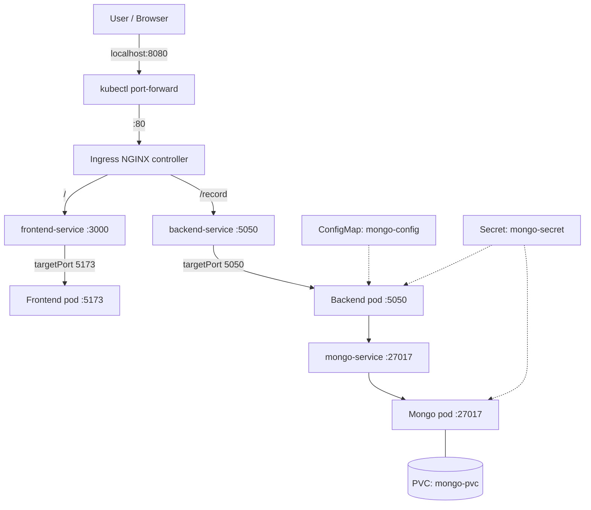

# Mern-Kubernetes-Deployment
# MERN on Kubernetes

A 3-tier MERN application (React/Vite frontend, Node/Express backend, MongoDB) deployed on a local Kubernetes cluster (minikube) using NGINX Ingress, a ConfigMap, a Secret and a PVC-backed MongoDB.

I built this to learn how the pieces of Kubernetes fit together: how traffic enters the cluster, how Services find Pods, how configuration and credentials are injected, and how to debug it when it breaks. The [Troubleshooting log](#troubleshooting-log) lists the real problems I hit and how I diagnosed them.

## Architecture



<!-- Optional: add your hand-drawn diagram to docs/architecture.png and uncomment the next line -->
<!--  -->

### Request flow and ports

| Hop | Port | Notes |
|---|---|---|
| Browser → your PC | `8080` | Opened by `kubectl port-forward`; local clusters have no public IP |
| Port-forward → Ingress controller | `80` | Service `ingress-nginx-controller` |
| Ingress → frontend-service | `3000` | Rule: path `/` |
| Ingress → backend-service | `5050` | Rule: path `/record` |
| frontend-service → frontend pod | `5173` | Service `targetPort`; Vite's default dev port |
| backend-service → backend pod | `5050` | Express server |
| backend → mongo-service → mongo pod | `27017` | Reached by Service DNS name |

## What each manifest does

| File | Kubernetes object(s) | Purpose |
|---|---|---|
| `configmap.yaml` | ConfigMap `mongo-config` | Non-secret DB settings (`HOST`, `PORT`) |
| `secret.example.yaml` | Secret `mongo-secret` (template) | DB username/password placeholders. The real `secret.yaml` is git-ignored |
| `pvc.yaml` | PersistentVolumeClaim `mongo-pvc` | 1Gi of storage so MongoDB data survives pod restarts |
| `mongo.yaml` | Deployment + Service `mongo-service` | MongoDB, mounted at `/data/db`, root user created from the Secret |
| `backend.yaml` | Deployment + Service `backend-service` | Express API; builds its Mongo connection string from the Secret and ConfigMap |
| `frontend.yaml` | Deployment + Service `frontend-service` | React/Vite app |
| `ingress.yaml` | Ingress `minimal-ingress` | Routes `/` to the frontend and `/record` to the backend |

## Tech stack

React + Vite 5, Node.js + Express, MongoDB, Docker, Kubernetes (minikube), Ingress-NGINX.

## Prerequisites

- Docker
- [minikube](https://minikube.sigs.k8s.io/) and `kubectl`
- The application source code for the frontend and backend (images are built locally, see below)

## Run it

**1. Start the cluster and an ingress controller**

```powershell
minikube start
minikube addons enable ingress
kubectl get pods -n ingress-nginx      # controller should be Running
kubectl get ingressclass               # should list "nginx"
```

The `ingressClassName` in `ingress.yaml` must match the class name shown here.

**2. Build the images inside minikube's Docker daemon**

So the cluster can use them without a registry. In the folders containing your frontend and backend Dockerfiles:

```powershell
# PowerShell
minikube docker-env | Invoke-Expression
# bash: eval $(minikube docker-env)

docker build -t mern-frontend:v2 .      # in the frontend folder
docker build -t mern-backend:<tag> .    # in the backend folder
```

The image names and tags must match the `image:` fields in `frontend.yaml` and `backend.yaml`.

**3. Create the real Secret**

`secret.yaml` is deliberately not in this repo. Copy the template and fill it in with your own base64 values:

```powershell
Copy-Item secret.example.yaml secret.yaml

# generate a base64 value (PowerShell)
[Convert]::ToBase64String([Text.Encoding]::UTF8.GetBytes("your-value"))
# generate a base64 value (bash)
echo -n 'your-value' | base64
```

Base64 is encoding, not encryption. Anyone with read access to the Secret can decode it.

**4. Apply the manifests (config and storage first)**

```powershell
kubectl apply -f secret.yaml -f configmap.yaml -f pvc.yaml
kubectl apply -f mongo.yaml -f backend.yaml -f frontend.yaml -f ingress.yaml
```

**5. Expose the ingress controller locally**

Leave this running in its own terminal:

```powershell
kubectl port-forward -n ingress-nginx svc/ingress-nginx-controller 8080:80
```

**6. Open the app** at <http://localhost:8080>

## Verify it works

```powershell
kubectl get pods                      # all Running, 1/1
kubectl get endpoints                 # every Service lists an IP:port, none show <none>
kubectl describe ingress minimal-ingress
kubectl logs deploy/backend-deployment    # should show a successful MongoDB connection
```

Test persistence: add a record in the app, then delete the Mongo pod and confirm the record is still there after it restarts.

```powershell
kubectl delete pod -l app=mongo
kubectl get pods -w
```

## Troubleshooting log

Problems found while building this, how each was found, and the fix. "Found by review" means I caught it reading the manifests before it caused a failure.

| # | Symptom | How I found it | Root cause | Fix |
|---|---|---|---|---|
| 1 | Ingress had no effect | `kubectl get pods -n ingress-nginx` returned "No resources found" | An Ingress is only a set of rules. Nothing was running to act on them | Installed an ingress controller and matched `ingressClassName` to the class from `kubectl get ingressclass` |
| 2 | `502 Bad Gateway` on `/` | Ingress controller logs: `connect() failed (111: Connection refused) ... upstream 10.244.0.5:3000` | The Service forwarded to port 3000, but the Vite app inside the container listens on 5173 | Set the Service `targetPort` to `5173`. Confirmed the real port from `kubectl logs` on the frontend pod |
| 3 | Records not saved: `POST /record` returned 500, `GET /record` returned 502 | Backend logs: `MongoServerSelectionError: no such command: 'hello'` | `mongo:4.2.6` predates the `hello` command that the Node driver uses for its handshake | Upgraded the Mongo image, then deleted and recreated the PVC (old data files and the one-time root-user init need an empty data directory) |
| 4 | Backend had no pods behind its Service (found by review) | Reading the manifests | Backend Deployment was labelled `app: mongo` while `backend-service` selected `app: backend`. It would also have let `mongo-service` route to backend pods | Used `app: backend` consistently in labels, selector and template |
| 5 | Would fail with `CreateContainerConfigError` (found by review) | Reading the manifests | ConfigMap keys were `host`/`port` but the Deployment referenced `HOST`/`PORT` (keys are case-sensitive). The host `mongo` also did not match the Service name `mongo-service` | Aligned the key names and set `HOST: mongo-service` |
| 6 | Mongo would start without a root user (found by review) | Reading the manifests | Used `MONGO_USERNAME`/`MONGO_PASSWORD`, which the official image ignores | Switched to `MONGO_INITDB_ROOT_USERNAME` and `MONGO_INITDB_ROOT_PASSWORD` |
| 7 | Route mismatch (found by review) | Compared the ingress to the backend code | Ingress path was `/records`, but the Express router is mounted at `/record` (`records` is the Mongo collection name) | Set the ingress path to `/record` |
| 8 | `curl -i` failed in PowerShell | Error message | In PowerShell, `curl` is an alias for `Invoke-WebRequest` | Use `curl.exe` |

### Debugging order I follow

1. `kubectl get pods`: is everything Running? Check RESTARTS.
2. `kubectl get endpoints`: does each Service have backing pods? `<none>` means the selector does not match the pod labels.
3. Ingress controller logs: `404` means no rule matched, `503` means no endpoints, `502` means the pod was reached but refused or broke the connection.
4. `kubectl logs` and `kubectl describe pod` on the failing pod.
5. `kubectl port-forward` straight to a pod or Service to test it without the ingress.

## Design decisions

- **Ingress instead of one NodePort/LoadBalancer per service.** One entry point routes by path, so the browser only needs one address and the frontend can call `/record` with a relative URL.
- **Services for stable networking.** Pod IPs change on every restart. Pods reach MongoDB through the DNS name `mongo-service`.
- **ConfigMap for settings, Secret for credentials.** Both are injected as environment variables, so the images contain no environment-specific values.
- **PVC for MongoDB.** Without it, the database is wiped whenever the pod is rescheduled.
- **`secret.yaml` is git-ignored.** Only a template is committed.

## Known limitations and next steps

Honest list of what this project does not do yet:

- **The frontend runs the Vite dev server** (`vite --host 0.0.0.0`). A production setup would use a multi-stage Docker build and serve the static `dist/` files with nginx.
- **No readiness or liveness probes and no resource requests/limits.**
- **MongoDB runs as a single-replica Deployment.** A StatefulSet (or a managed database) is the better fit for a stateful workload.
- **Secrets are plain base64 Secrets.** Real environments would use encryption at rest plus Sealed Secrets or an external secrets manager.
- **No TLS and no CI/CD.** Planned: GitHub Actions to build and push images, Terraform for cloud infrastructure, and monitoring.
- **Ingress-NGINX has been retired** (maintenance ended March 2026). It is fine for learning, but a new production setup should use a maintained controller or the Gateway API.

## Cleanup

```powershell
kubectl delete -f ingress.yaml -f frontend.yaml -f backend.yaml -f mongo.yaml -f configmap.yaml -f secret.yaml
kubectl delete -f pvc.yaml      # this deletes the stored MongoDB data
minikube stop
```

## Project structure

```
.
├── backend.yaml
├── configmap.yaml
├── frontend.yaml
├── ingress.yaml
├── mongo.yaml
├── pvc.yaml
├── secret.example.yaml     # template; real secret.yaml is git-ignored
└── README.md
```
